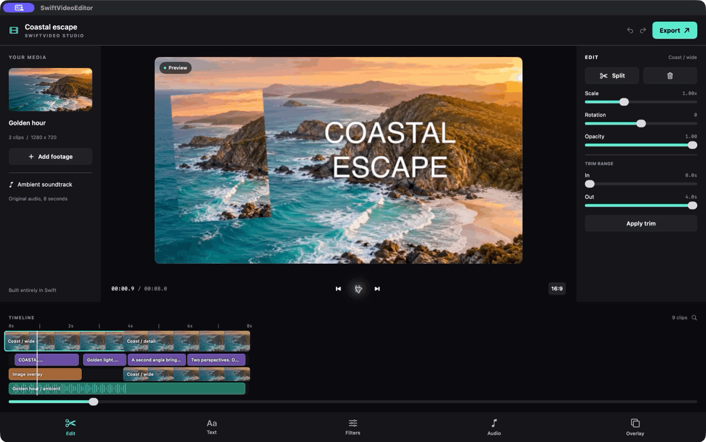

<!-- Copyright 2026 Software Deck Pty Ltd; SPDX-License-Identifier: Apache-2.0 -->
# SwiftVideo

[](https://github.com/shial4/SwiftVideo/actions/workflows/apple.yml)
[](https://github.com/shial4/SwiftVideo/actions/workflows/android.yml)
[](https://github.com/shial4/SwiftVideo/releases)
[](Package.swift)
[](Package.swift)
[](Documentation/Testing.md)
[](https://skip.dev)
[](LICENSE)

**Compose, edit, animate, and export video in Swift. One timeline model for iOS, macOS, and Android.**

[Install](#install) | [Quick start](#quick-start) | [Capabilities](#capabilities) | [Example editor](Example) | [Tests and coverage](Documentation/Testing.md) | [API guide](Documentation/Guide.md)



## Why SwiftVideo?

- **Use Swift throughout.** Native Swift models, actors, editing, and animation evaluation. Android codecs run through a small Swift-authored Skip service.
- **Compose like SwiftUI.** Build immutable tracks and clips with a result builder, fluent modifiers, conditionals, and loops. Use the values in SwiftUIComponents or any Swift app.
- **Render on the GPU.** Metal-backed Core Image on Apple and OpenGL through Media3 on Android handle transforms, filters, and layer composition.
- **Edit predictable timelines.** Exact rational time, immutable Codable snapshots, atomic edit batches, and preserved effect timing after splits and trims.
- **Export real media.** AVFoundation and Core Image on Apple; Media3 Transformer on Android. Progress, cancellation, and protected output files are built in.

## Install

```swift
// Package.swift
.package(url: "https://github.com/shial4/SwiftVideo.git", from: "0.0.1")

// Your target's dependencies:
.product(name: "SwiftVideo", package: "SwiftVideo")
```

| Platform | Requirements |
| --- | --- |
| iOS / iPadOS | iOS 17+, Swift 6.3+ |
| macOS | macOS 14+, Swift 6.3+ |
| Android | API 28+, Skip Fuse app, matching Swift Android SDK/toolchain |

Android requires an initialized Skip app context and the generated Media3 JVM module. See the [build instructions](Documentation/Testing.md); a standalone Swift command-line process does not provide Android media services.

## Quick start

```swift
import SwiftVideo

let duration = try VideoTime(value: 5, timescale: 1)
let project = VideoProject {
    MediaTrack("Footage") {
        MediaClip.video(inputURL, duration: duration)
    }
    MediaTrack("Title") {
        MediaClip.text("Your story", duration: duration, style: TextStyle(fontSize: 96))
            .zIndex(1)
            .transform(VisualTransform(y: 0.8, width: 0.9, height: 0.15))
    }
}

let exporter = VideoExporter()
try await exporter.export(project, to: outputURL,
                          settings: ExportSettings(resolution: .hd1080)) { progress in
    print(progress.fraction)
}
```

`inputURL` must reference readable media and `outputURL` must be a new local file. Progress callbacks are `@Sendable`; hop to `MainActor` when updating UI. Cancel the calling task or use `await exporter.cancel()`.

### A title scene, picture-in-picture, and captions

```swift
let two = try VideoTime(value: 2, timescale: 1)
let six = try VideoTime(value: 6, timescale: 1)
let project = VideoProject {
    MediaTrack("Background") {
        MediaClip.video(footageURL, duration: six)
    }
    MediaTrack("Overlays") {
        MediaClip.image(photoURL, duration: two)
            .zIndex(1)
            .transform(VisualTransform(x: 0.2, width: 0.3, height: 0.7, contentMode: .fill))
        MediaClip.text("A new perspective", duration: two)
            .zIndex(2)
            .transform(VisualTransform(x: 0.65, width: 0.6, height: 0.2))
        MediaClip.video(commentaryURL, duration: two)
            .starting(at: two).zIndex(1)
            .transform(VisualTransform(x: 0.8, y: 0.25, width: 0.3, height: 0.3))
        MediaClip.text("Here is what happens next.", duration: two)
            .starting(at: two).zIndex(2)
            .transform(VisualTransform(y: 0.9, width: 0.9, height: 0.12))
    }
}
```

Clip times use the project timeline. Video source time starts at zero unless you add `.sourceStarting(at:)`. Captions are ordinary timed text clips. [The bundled demo](Example/Sources/SwiftVideoEditor/EditorDocument.swift) adds animation, music, and several captions to this pattern.

### Use with SwiftUI state

Store `VideoProject` in an `@Observable` model or `@State`, and pass a snapshot to `VideoExporter` from a task. Builders only create values; they perform no media I/O. Modifiers preserve clip identity. When rebuilding from view inputs, pass stable `id:` values from your model so selection and edits continue to target the same clips.

The library has no SwiftUI dependency. Rendering and editing actors work outside the main actor; only UI updates and Apple's one-time text preparation use it. The example debounces preview exports and cancels superseded work. See the [SwiftUI integration guide](Documentation/Guide.md#integrate-with-swiftuicomponents-or-another-swiftui-app).

### Split, trim, and arrange

```swift
let track = MediaTrack(name: "Footage")
let editor = try VideoEditor(project: VideoProject(tracks: [track]))
let arranged = try await editor.apply([
    .mergeSequentially(clips, trackID: track.id, start: .zero)
])
let first = arranged.tracks[0].clips[0]
let edited = try await editor.apply([
    .split(first.id, at: try VideoTime(value: 2, timescale: 1), rightID: UUID())
])
```

A failed batch leaves the previous project intact. Splits use project time; trims keep a range relative to the clip's beginning. Both preserve source offsets and the original animation and audio envelope. [Editing semantics](Documentation/Guide.md#timeline-and-editing).

## Capabilities

| Video and images | Text and animation | Audio and export |
| --- | --- | --- |
| Multiple overlapping tracks | Text with font, alignment, color, shadow | Mix music and video audio |
| Split, trim, offset, sequential clips | Position, scale, rotation, opacity keyframes | Gain, mute, stereo pan, fades |
| Crop, fit, fill, stretch, rotation | Linear, ease-in, ease-out, smooth, step | H.264 / HEVC, configurable bitrate |
| Brightness, contrast, saturation, blur, sepia | Image overlays and picture-in-picture | Resolution, frame rate, progress, cancellation |


Apple supports MP4/MOV and rational frame rates. Android supports MP4 and integer frame rates. Output is SDR; device encoder limits and platform font/color differences apply. Use local font files for portable typography. See [platform limits](Documentation/Guide.md#platform-architecture-and-limits) and [GPU/CPU responsibilities](Documentation/Guide.md#rendering-and-performance).

## Example editor

[**SwiftVideo Studio**](Example) is a dark, timeline-based editor inspired by familiar mobile video tools. It includes bundled coastal footage, an original ambient soundtrack, editable titles, filters, transforms, picture-in-picture, undo/redo, scrubbing, playback, and 720p/1080p export. Its preview and export both use the library's rendering engine.

Open `Example/Project.xcworkspace` and run **SwiftVideoEditor App**, or follow the [iOS and Android instructions](Example/README.md). The example edits bundled media and keeps the current project in memory; it is a demonstration app, not a full media-management product.

## Tests and coverage

[](Documentation/Coverage/ios.json)
[](Documentation/Coverage/android-core.json)
[](Documentation/Coverage/android-media3.json)

Coverage badges describe the **0.0.1 verification snapshot**, not a live third-party coverage service. CI runs both platforms and uploads fresh reports. [Exact scope, thresholds, results, and reproduction](Documentation/Testing.md).

Tests exercise rational time, validation, serialization, atomic edits, split/trim continuity, audio envelopes, cancellation, destination protection, and real exported media. Integration tests independently decode frames and PCM audio to verify composition, motion, filters, opacity, resolution, duration, and fades.

```sh
swift test --disable-xctest --enable-code-coverage
swift test --package-path Example --disable-xctest
swift Tools/CheckHeaders.swift
```

## License

Copyright 2026 Software Deck Pty Ltd. First-party work is licensed under [Apache 2.0](LICENSE). See [NOTICE](NOTICE), [dependency licenses and corresponding source](Documentation/ThirdParty), and [example asset provenance](Example/ASSETS.md). SwiftVideo is not affiliated with CapCut or ByteDance.
